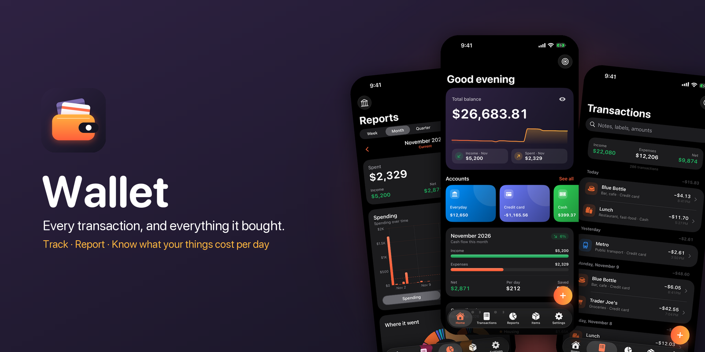
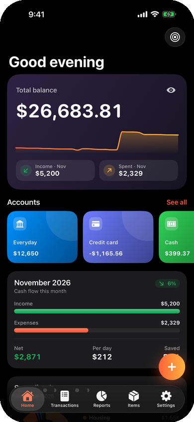
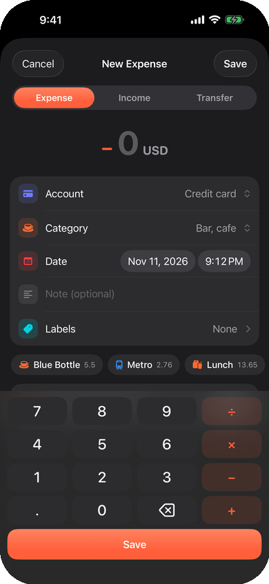
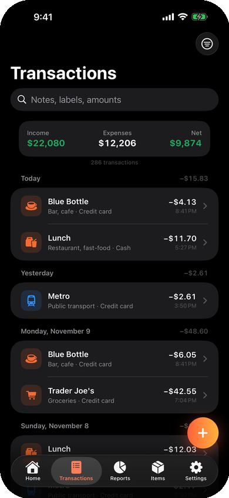
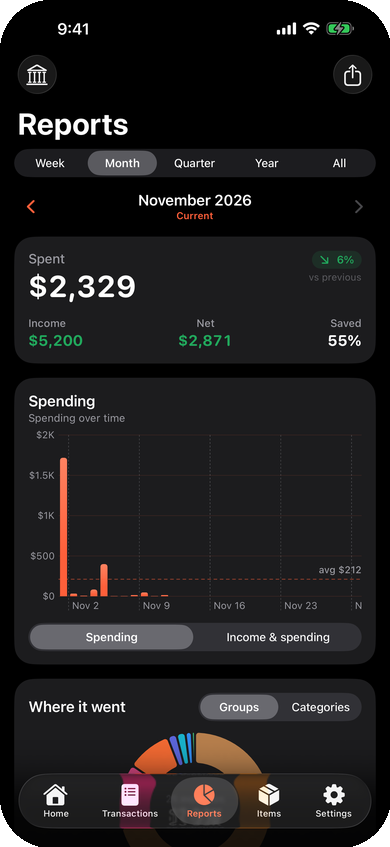
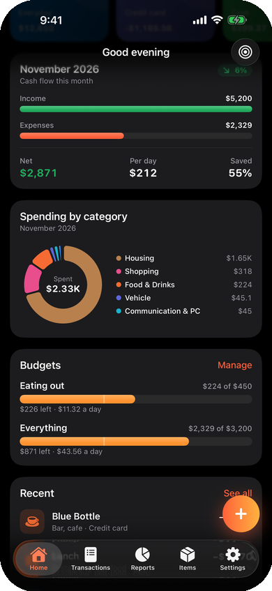
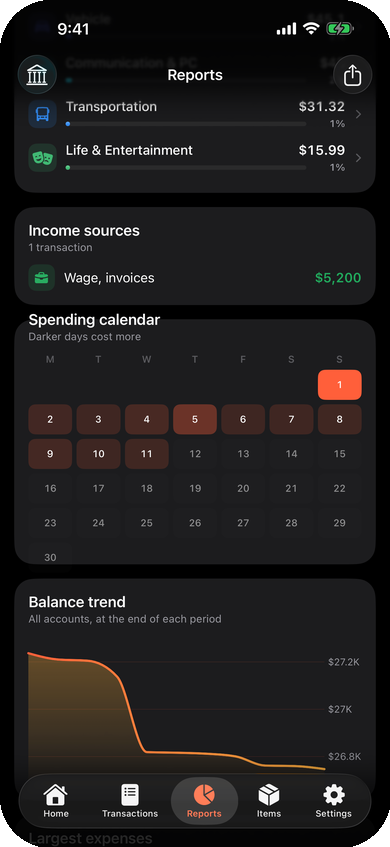
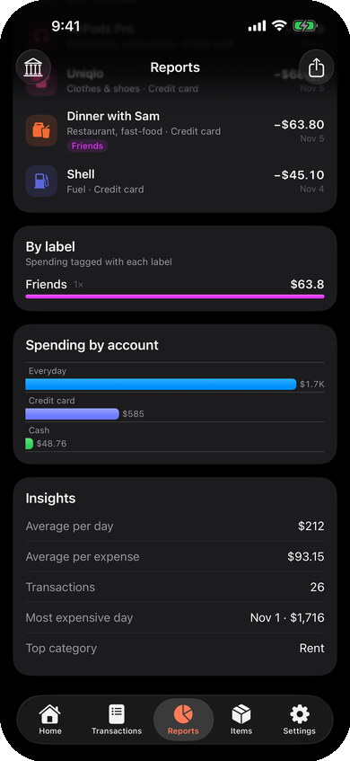
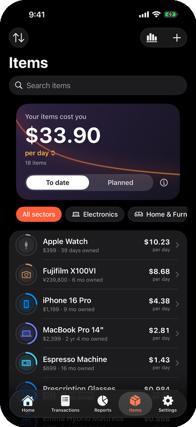

<p align="center">
  
</p>

<p align="center">
  <b>A private, beautifully fast money tracker for iPhone, which also tells you what the things you buy really cost per day.</b>
</p>

<p align="center">
  
  
  
  
  
</p>

---

## Why Wallet?

Most expense trackers stop at the receipt. A $1,200 laptop shows up as one big
expense in March and then disappears. **Wallet keeps the receipt *and* follows
the thing you bought**: "$1.10 a day, and falling". The longer you keep it,
the better the purchase looks.

It's also everything you'd expect from a serious wallet: accounts in any
currency, transfers, budgets, labels, deep reports, Shortcuts & Siri, and a
one-tap import from BudgetBakers Wallet. No account, no server, no analytics.

## A quick tour

<table>
  <tr>
    <td align="center" width="25%"><br><b>Home</b><br><sub>Balance trend, accounts, this month at a glance</sub></td>
    <td align="center" width="25%"><br><b>Log in seconds</b><br><sub>Calculator keypad + suggestions from your history</sub></td>
    <td align="center" width="25%"><br><b>Transactions</b><br><sub>Grouped by day, searchable, filterable</sub></td>
    <td align="center" width="25%"><br><b>Reports</b><br><sub>Any week, month, quarter or year</sub></td>
  </tr>
  <tr>
    <td align="center"><br><b>Budgets</b><br><sub>Pace markers and a daily allowance</sub></td>
    <td align="center"><br><b>Spending calendar</b><br><sub>Income sources and balance trend</sub></td>
    <td align="center"><br><b>Insights</b><br><sub>Labels, accounts, largest expenses</sub></td>
    <td align="center"><br><b>What things cost per day</b><br><sub>Every purchase, amortised</sub></td>
  </tr>
</table>

## Features

### 💳 Wallet
- **Accounts:** bank, cash, credit cards, e-wallets, savings, investments and loans, each in its own currency. Archive old ones, or keep savings out of your spending statistics.
- **Fast entry:**
  - A calculator keypad that does sums (`120+45×2`).
  - Notes that complete themselves from your history and fill in the category, account and usual amount.
  - Labels.
  - Transfers between accounts, including across currencies.
- **Transactions:** grouped by day with daily totals. Search notes, labels and amounts; filter by period, type, account, category and label; swipe to duplicate or delete (with undo).
- **Budgets:** weekly, monthly or yearly, for everything or for chosen categories, with a pace marker and "what's left per day".

### 📊 Reports
- Week, month, quarter, year or all time. Swipe between periods, or narrow to a single account.
- Spending compared with **the same stretch** of the previous period (1–11 Nov vs 1–11 Oct, not vs all of October), plus your savings rate.
- A spending or cash-flow chart, a group and category breakdown, and drill-down into any category's 12-period trend and transactions.
- A spending calendar, weekday averages, balance trend, income sources, largest expenses, labels, and spending by account.
- **Every chart is a filter:**
  - Tap a slice, bar, calendar day, weekday, label, income source or account, and the whole report narrows to it.
  - Tap a month bar in a year view to zoom in.
  - Jump to the matching transactions with one tap.
- CSV export of any period.

### 📦 Ownership: the twist
- Turn any purchase into a **tracked item**: from the transaction, from the composer, or from Home's *"Bought something lasting?"* suggestions.
- See its cost per day two ways: **To date** (price ÷ days owned) and **Planned** (price ÷ expected lifetime).
- Link repairs and accessories as **upkeep** to get the true total cost of ownership.
- Retire items when you're done with them, and record resale value.

### ⚡️ Shortcuts & Siri
- **Add Transaction** takes an amount, type, account, category, note, merchant, date and labels. Leave the category out and Wallet picks the one you usually use.
- **Get Balance**, **Get Spending** and **New Transaction**, which opens straight to the keypad.
- **Log every Apple Pay payment automatically.** In Shortcuts, add a *Transaction* automation that runs Wallet's *Add Transaction* (full steps in Settings → Shortcuts & Siri).

### 🔒 Private by design
- Everything lives on your device in SwiftData. The only network request is an optional exchange-rate lookup for foreign-currency entries.
- An optional **Face ID / Touch ID / passcode lock**, which also hides the app in the app switcher.
- **Hide balances** blurs every figure until tapped.
- Exports are written with complete file protection, and CSV cells are escaped against spreadsheet formula injection.

### 🔁 Coming from BudgetBakers Wallet?
In **Settings → Import from BudgetBakers**, pick Wallet's CSV export. It brings over:
- accounts, categories (mapped by Wallet's own IDs) and labels
- notes, including multi-line ones
- foreign-currency rates
- transfers, re-paired from Wallet's two-line format

Import again with a newer export at any time; only new records are added.

### 🌍 Also
Full JSON backup and restore (additive, never overwrites) and localisation in
12 languages: English, 繁體中文, 简体中文, 日本語, 한국어, Bahasa Indonesia, Español,
Français, Deutsch, Português (Brasil), Русский and Tiếng Việt.

## Getting started

**Requirements:** Xcode 16 or later with the iOS 18 SDK.

```bash
git clone https://github.com/stanleyowen/Wallet.git
cd Wallet
open Wallet.xcodeproj
```

Run the **Wallet** scheme. Debug builds accept a few launch arguments:

| Argument | What it does |
|---|---|
| `-seedSampleData` | Sample accounts, four months of transactions, budgets and items |
| `-importWalletCSV <path>` | Imports a BudgetBakers CSV export on launch |
| `-skipOnboarding`, `-initialTab <tab>`, `-openComposer`, `-scrollAnchor center\|bottom` | For scripted simulator screenshots |

> The bundle identifier is still `com.stanley.Dayrate`, so existing installs of
> the app's earlier versions (Dayrate, Tally) upgrade in place and keep their data.

## How it's built

```
Wallet/
├── WalletApp.swift        App entry: tabs, app lock, global sheets
├── Models/                Record, Account, Budget, RecordCategory, Item (Gadget)…
├── Support/
│   ├── Ledger.swift        Balances, net worth: pure functions over value snapshots
│   ├── ReportEngine.swift  Periods, reports, budgets
│   ├── WalletImport.swift  BudgetBakers CSV → import plan (CSV.swift parses)
│   ├── Suggestions.swift   Learns notes → category / account / amount
│   └── AppLock.swift, Backup.swift, Theme.swift, …
├── Intents/               App Intents for Shortcuts & Siri
└── Views/                 Home, Transactions, Reports, Items, Settings, editors
WalletTests/               Swift Testing suites
Design/                    App icon + README image generators, screenshots
Localization/              Translation sources and catalog builder
```

**Principles:**
- **The math is pure and tested.** All money math runs on immutable `Flow` snapshots.
- **Edits are drafts.** Editors bind to plain structs, so Cancel is always a true no-op.
- **Writes are non-destructive.** Imports and restores only ever add.

Run the tests:

```bash
xcodebuild test -project Wallet.xcodeproj -scheme Wallet \
  -destination 'platform=iOS Simulator,name=iPhone 17'
```

### Regenerating assets
```bash
python3 Design/make_icon.py Wallet/Assets.xcassets/AppIcon.appiconset   # app icon (needs Pillow)
python3 Design/make_readme_images.py <screenshots_dir> Design/screenshots  # README images
python3 Localization/build_catalog.py                                    # string catalog
```

README screenshots are always taken from a simulator seeded with `-seedSampleData`,
never from real data.

## License

Wallet is free software: you can redistribute it and/or modify it under the
terms of the **GNU General Public License v3.0** as published by the Free
Software Foundation. See [`LICENSE`](LICENSE) for the full text.
